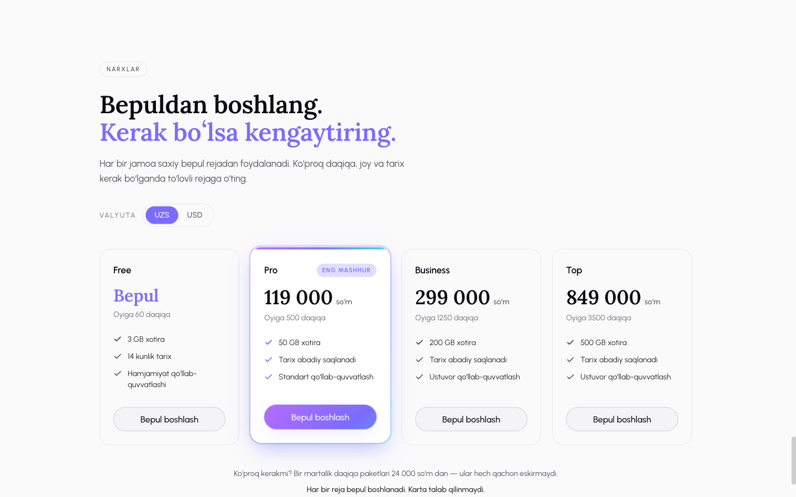
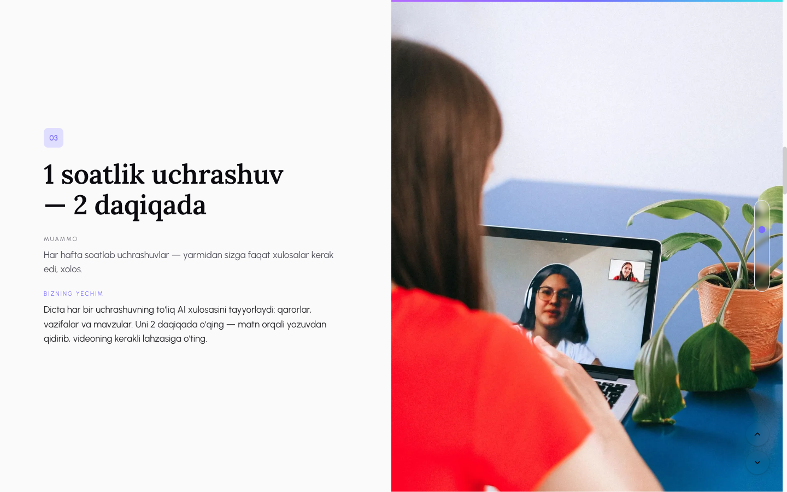

# Dicta — marketing site

[](https://github.com/norlas-com/dicta_landing/actions/workflows/ci.yml)
[](LICENSE)

The public marketing site for **[dicta.uz](https://dicta.uz)** — Astro + Tailwind, statically
generated, served from Cloudflare Pages. This is the front door; the product itself lives at
[meet.dicta.uz](https://meet.dicta.uz).

**Dicta** is a meeting platform built for Uzbekistan. You host the call, and Dicta records it,
transcribes it, and writes the summary — decisions, action items, topics — in **Uzbek, Russian or
English**. It also joins Zoom, Google Meet and Microsoft Teams calls as a notetaker bot, and ships
as a web app, a desktop app (macOS + Windows), and native iOS and Android apps.


---

## Why this repo is interesting

It is a small site, but it solves a few problems that are easy to get wrong:

**Three languages, one static build, no client-side i18n.** Uzbek is the default and is served
*unprefixed* (`/`, `/download`), while Russian and English get a path prefix (`/ru/…`, `/en/…`).
That is Astro's [`i18n` config](astro.config.mjs) with `prefixDefaultLocale: false`, plus a small
set of helpers in [`src/i18n/utils.ts`](src/i18n/utils.ts) — `localePath()` for building
locale-aware internal links and `switchLocalePath()` which powers both the language switcher and
the `hreflang` tags. Every string lives in one typed dictionary,
[`src/i18n/ui.ts`](src/i18n/ui.ts). Each route exists twice: once as a plain page for the default
locale ([`src/pages/index.astro`](src/pages/index.astro)) and once behind a `[lang]` dynamic route
with `getStaticPaths` for the other two. Result: 18 fully static HTML pages, zero i18n JavaScript
shipped to the browser.

**Real prices, baked at build time.** The pricing section is not hardcoded and it is not fetched in
the browser. At `astro build`, [`src/lib/catalog.ts`](src/lib/catalog.ts) calls the product's public
billing API (`api.dicta.uz/v1/billing/catalog`) and bakes the actual plans into the HTML; a
Cloudflare Pages deploy hook plus a nightly rebuild keeps them fresh. The same trick resolves the
current desktop version from the `electron-updater` feeds in
[`src/lib/desktop.ts`](src/lib/desktop.ts), so the download buttons always point at a release that
exists. Both loaders fail *soft* — the catalog returns `null` and the pricing section is skipped
entirely rather than rendering a broken or stale price, and the version resolver falls back to a
pinned known-good release. A marketing site should never be able to break because an API blinked.



**A scroll-driven product story.** The home page is seven full-viewport screens, each framing a
problem and then the answer to it, alternating sides with a full-bleed photo —
[`src/components/FeatureStory.astro`](src/components/FeatureStory.astro) plus
[`FeatureScreen.astro`](src/components/FeatureScreen.astro). It uses CSS scroll-snap on the root
scroller, with `data-snap-free` escape hatches around the taller header/pricing/footer regions so
those still scroll normally. A fixed dot rail and arrow rail track the active screen, and each
screen re-animates as it becomes active.



**Edge routing for a site that used to be the whole app.** `dicta.uz` was the app's home before it
moved to `meet.dicta.uz`, so old links must keep working:

- [`public/_redirects`](public/_redirects) — 301s the known app paths (`/m/*`, `/recap/*`,
  `/billing/*`, …) to the app host.
- [`functions/_middleware.js`](functions/_middleware.js) — a Cloudflare Pages Function for the one
  case `_redirects` cannot express: root-level meeting share codes like `dicta.uz/abc-defg-hij`
  match a regex, not a static rule.
- [`public/_headers`](public/_headers) — forces `Content-Type: application/json` on the
  extensionless `apple-app-site-association` file. Without it Pages serves it as
  `octet-stream` and iOS Universal Links silently stop working.
- [`public/.well-known/`](public/.well-known/) — the AASA and `assetlinks.json` that let already-
  installed iOS and Android builds open `dicta.uz` links natively.

**Dark mode with no flash.** Theme tokens are CSS custom properties in
[`src/styles/global.css`](src/styles/global.css), consumed through
[`tailwind.config.mjs`](tailwind.config.mjs). An inline script in the layout applies the stored
preference before first paint, so there is no white flash on a dark-mode load.

## Stack

| | |
|---|---|
| Framework | [Astro 5](https://astro.build) — static output, zero JS by default |
| Styling | Tailwind CSS 3, design tokens shared with the product app |
| Type | Lora (serif display) + Urbanist (UI), self-hosted via `@fontsource` |
| Hosting | Cloudflare Pages + one Pages Function |
| SEO | canonical + `hreflang` (incl. `x-default`), OpenGraph/Twitter cards, JSON-LD (`Organization`, `SoftwareApplication`), generated sitemap |

## Develop

Requires Node 22.

```bash
npm install
npm run dev        # http://localhost:4321
npm run build      # -> dist/
npm run preview    # serve the built output
npx astro check    # typecheck
```

The build reaches out to `api.dicta.uz` and `downloads.dicta.uz` for pricing and version data. It
works offline too — you just get the fallbacks.

## Deploy

Cloudflare Pages, connected to this repository. Build command `npm run build`, output directory
`dist`, `NODE_VERSION=22`. Pushing to `main` deploys. The CI workflow in this repo is a build check
only and does not deploy anything.

## License

Source code is [MIT](LICENSE).

The **Dicta brand, the imagery, and the marketing and legal copy are not covered by it** — see
[NOTICE](NOTICE) for the exact list. In short: take the code, bring your own brand and your own
words.
