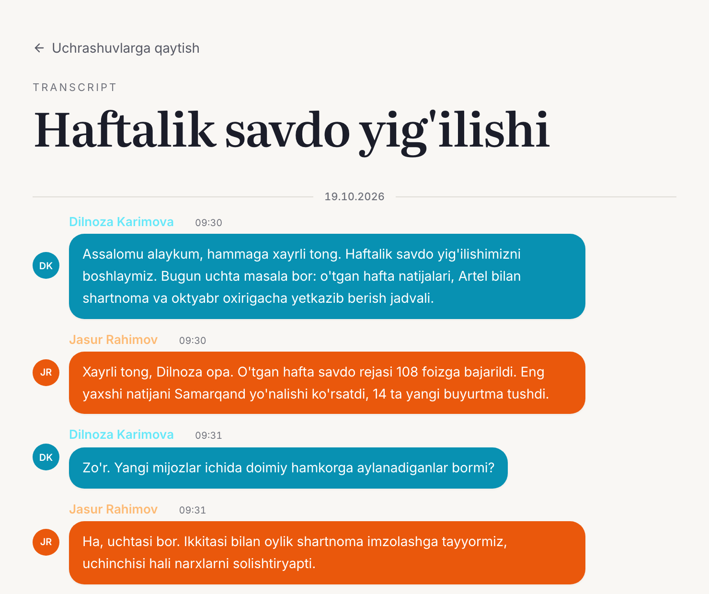
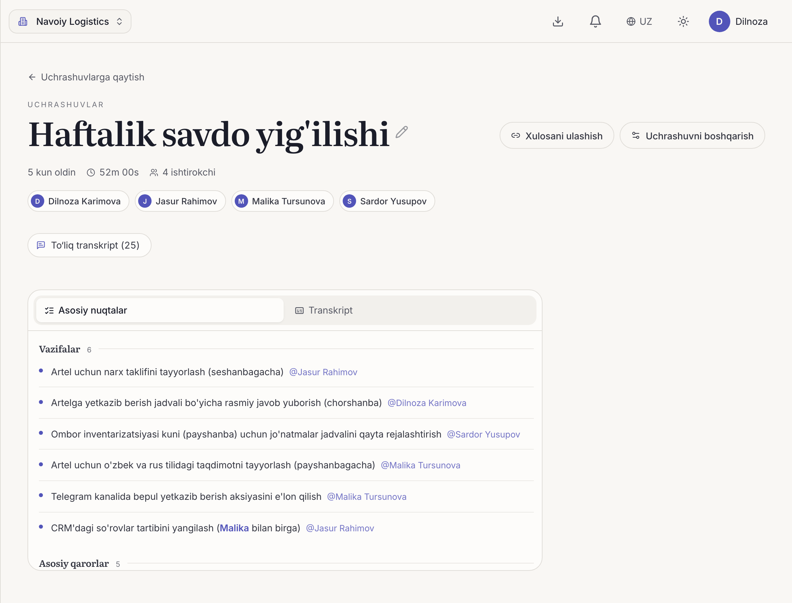
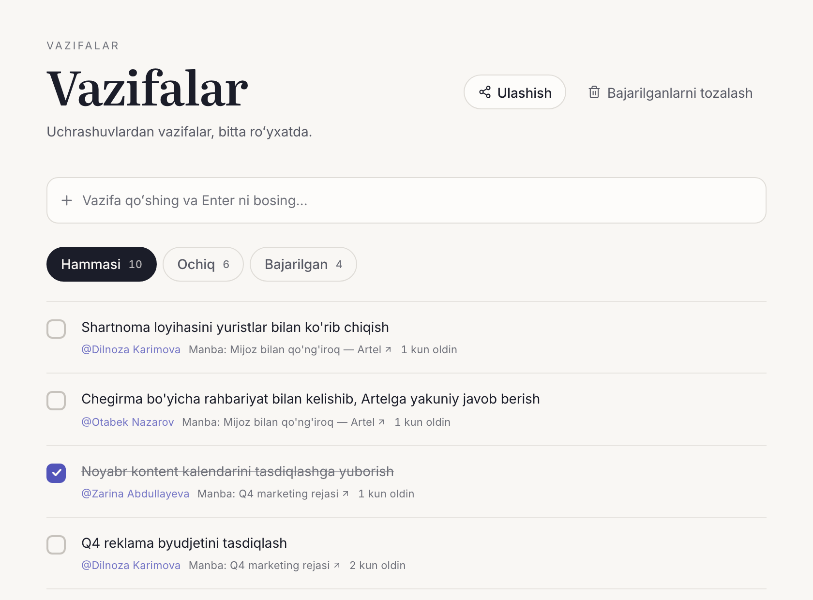

Календарь владельца компании почти целиком состоит из разговоров: планёрки с командой, переговоры с поставщиками, звонки клиентам, собеседования. Решения, принятые в них, и есть бизнес. Проблема в том, что большинство из них живёт только в чьей-то памяти.

Ниже показано, как выглядит обычный рабочий день, когда эти разговоры берёт на себя Dicta. Сценарий построен на том, что Dicta действительно умеет: подставьте свои встречи, и ритм покажется знакомым.

## 9:00. Начать со вчерашних решений, а не со вчерашних заметок

Вместо того чтобы листать чаты, руководитель открывает резюме, которые пришли в Telegram после вчерашних встреч. Каждое из них — короткое [AI-резюме](/ru/features/ai-summary) с темами, решениями и задачами, которое читается примерно за две минуты.

Что-то неясно? [**AI-чат**](/ru/features/ai-chat) отвечает на вопросы по прошлым встречам: «О каких сроках поставки мы договорились с поставщиком?» Ответ берётся из самой встречи, а не из памяти.

## 10:00. Планёрка в комнате встреч Dicta

Команда подключается к [встрече в Dicta](/ru/use-cases/online-meetings) из браузера или приложения. Гости и подрядчики заходят по ссылке, без аккаунта и без установки.

Никого не назначают вести записи. Dicta записывает встречу, делает [транскрипт](/ru/features/transcription), где каждая реплика привязана к нужному спикеру, и готовит резюме.

Задачи, прозвучавшие в разговоре, создаются автоматически и назначаются ответственным. Их можно сразу отправить в [Jira, Trello, Asana или ClickUp](/ru/features/tasks-integrations).

Задача руководителя на планёрке — вести её, а не записывать.

## 11:30. Личная встреча с поставщиком

Не каждый важный разговор происходит на экране. Для [личных встреч](/ru/use-cases/offline-meetings) руководитель открывает мобильное приложение Dicta, нажимает одну кнопку и кладёт телефон на стол.

Dicta записывает разговор и автоматически разделяет спикеров. Для больших очных встреч есть [режим круглого стола](/ru/use-cases/round-table). После встречи у руководителя есть транскрипт с поиском и резюме с согласованными условиями, так что разговоров «а я думал, мы договорились иначе» становится меньше.

*О согласии: там, где этого требует закон, для записи нужно согласие участников. Предупреждайте людей, что ведёте запись.*

## 13:00. Два звонка одновременно? Отправьте бота

Звонки в Zoom, Google Meet или Microsoft Teams пересекаются. На тот, где руководитель не может быть, вместо него подключается [**бот Dicta**](/ru/use-cases/meeting-bot). Потом руководитель получает полный транскрипт и AI-резюме, где решения, касающиеся его, стоят вверху.

Для звонка, на котором руководитель присутствует сам, но не хочет видимого бота в комнате, есть [**приложение для компьютера**](/ru/features/desktop-app) (macOS и Windows). Оно распознаёт звонок и записывает его, не добавляя участника в комнату.

## 15:00. Звонок клиенту на узбекском, русском и английском сразу

Реальные разговоры у нас смешивают языки. Dicta распознаёт узбекский, русский и английский, поэтому звонок, в котором языки переключаются, всё равно превращается в один транскрипт с поиском. Письмо клиенту по итогам пишется по резюме, а не по воспоминаниям.

## 16:30. Превратить старые записи в текст

Всегда есть что-то накопившееся: записанное собеседование с кандидатом, голосовое сообщение из поездки, видео прошлой презентации. Руководитель [загружает](/ru/features/upload) аудио- или видеофайл и получает из него транскрипт и резюме. При найме собеседования можно перечитать и сравнить рядом.

## 17:30. Подвести итоги и подготовить завтра

Перед уходом руководитель спрашивает AI-чат, что осталось открытым по встречам этой недели, проверяет, что у созданных сегодня задач есть ответственные, и смотрит календарь на завтра. Первые завтрашние резюме будут ждать в Telegram.

## Что меняется

- **Записи перестают быть работой.** Никто не застревает в роли секретаря.
- **У решений появляются владельцы.** Задачи выходят из встречи с именами ответственных.
- **Память становится доступной для поиска.** Прошлые разговоры — на расстоянии одного вопроса.
- **Охвачен каждый канал.** Онлайн, вживую, на компьютере или загруженным файлом.

Полный список того, что умеет Dicta, — на странице [возможностей](/ru/features).

## Попробуйте в своём дне

Выберите завтрашнюю первую встречу, запишите её с Dicta и посмотрите на резюме после неё. Тарифы для больших команд — на странице [цен](/ru/pricing).

**[Начать бесплатно →](https://meet.dicta.uz/sign-up)**
